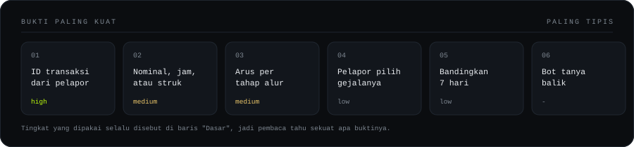

<p align="center">
  
</p>

<h1 align="center">Sidik</h1>

<p align="center">
  <b>Laporan transaksi gagal masuk. Jawaban keluar: worker yang mana.</b>
</p>

<p align="center">
  
  
  
  
</p>

---

Orang dari divisi mana pun cukup tulis keluhan di Teams. Beberapa detik kemudian bot menjawab: **worker mana yang gagal, divisi siapa pemiliknya, channel mana yang perlu di-tag,** plus tiga baris log sebagai bukti. Nggak ada yang perlu buka Loki.

Sekarang, satu laporan kayak gitu makan 10 sampai 30 menit: satu engineer buka Loki, nebak nama worker, cocokin jam, baca log mentah. Kalau yang lapor bukan orang teknis, separuh waktunya habis buat tanya balik.

## Coba dulu, 30 detik

```bash
pip install -e .
python -m sidik
```

Data contoh satu insiden sudah ikut di dalam repo, jadi Loki belum dibutuhkan buat lihat hasilnya.

## Contoh jawaban

Pelapor menulis ID transaksinya:

```
Penyebab: worker-payment (Payment Ops)
Keyakinan: high
Dasar: Transaksi TRX2026102900123 muncul di 1 worker, error hanya di worker-payment (2 baris).
Eskalasi ke: #payment-war-room
Sebaran: worker-payment=2
Bukti:
  14:00:43 worker-payment upstream timeout after 30000ms calling core-bank trx_id=TRX2026102900123 attempt=1
  14:00:44 worker-payment transfer marked failed, reversal queued trx_id=TRX2026102900123 card=[REDACTED-ID]
```

Pelapor cuma menulis *"transfer Rp1.250.000 jam 14:00 gagal masuk"*. Nggak ada ID. Bot tetap bisa jawab, karena dia mencari ID-nya sendiri di log:

```
Penyebab: worker-payment (Payment Ops)
Keyakinan: medium
Dasar: Transaksi TRX2026102900123 muncul di 1 worker, error hanya di worker-payment (2 baris).
ID yang dipakai: TRX2026102900123
Eskalasi ke: #payment-war-room
```

Bedanya `high` dan `medium` penting. `high` berarti ID-nya datang dari mulut pelapor. `medium` berarti bot yang menemukannya, dan itu satu langkah lebih jauh dari kepastian. Kalau tertulis `low`, jawabannya baru sebatas dugaan, dan alasannya selalu ikut ditulis.

Nomor kartu di log asli sudah hilang, berubah jadi `[REDACTED-ID]`. Ini bukan hiasan. Potongan log produksi ini tampil di channel yang dibaca banyak divisi, jadi data nasabah dibuang sebelum keluar.

## Cara memilih worker: lihat bukti yang ada

<p align="center">
  
</p>

Bot nggak mulai dari "pakai AI atau nggak". Bot mulai dari pertanyaan: **bukti apa yang ada?** Tiap tingkat punya cara jawab sendiri, dan tingkat yang dipakai selalu disebut di baris `Dasar`.

- **ID transaksi ada.** Ikuti ID itu ke semua worker. Kalau error cuma di satu worker, itu jawabannya.
- **Nggak ada ID, tapi ada nominal, jam, atau struk.** Cari baris log yang cocok, baca ID-nya dari baris itu, lalu lanjut seperti di atas.
- **Nggak ada ID, tapi arus transaksi kelihatan.** Hitung tiap tahap alur: berapa transaksi sampai payment, core, notify, settlement. Tahap yang paling banyak kehilangan, itu jawabannya.
- **Cuma gejala.** Tiga tombol di kartu Teams menyempitkan worker yang perlu dicek.
- **Cuma "ada yang error".** Bandingkan tiap worker dengan kebiasaannya sendiri tujuh hari terakhir di jam yang sama.
- **Nggak ada apa-apa.** Bot bilang belum bisa, dan minta satu data spesifik.

Yang memilih worker selalu kode biasa, bukan AI. AI cuma dipakai buat dua hal: menerjemahkan kalimat pelapor jadi parameter pencarian, dan menulis ringkasan. Dua-duanya opsional. Kalau modelnya mati, jawabannya tetap keluar.

## Kalau pelapornya cuma kirim gambar

Dua jenis gambar, dua jalan berbeda.

**Struk atau detail transaksi.** Isinya nominal, jam, dan potongan nomor rekening. Bot membaca teksnya, mengambil nominal dan jam, lalu mencari baris log yang nominalnya sama dan jamnya dekat. Dari baris itu bot membaca ID transaksinya sendiri. Pelapor nggak perlu tahu ID itu apa.

**Screenshot pesan error.** Yang terbaca biasanya kode error, bukan ID. Itu masih berguna: kode error menyempitkan worker, dan jam kirim pesan memotong jendela waktu dari 2 jam jadi beberapa menit.

Syaratnya `tesseract` terpasang di mesin bot (`sudo apt install tesseract-ocr`). Kalau belum ada, bot bilang terus terang dan minta nominal + jam diketik. Bot nggak pura-pura bisa membaca gambar.

## Kalau yang lapor banyak orang

Satu orang melapor "transfer gagal" tanpa ID, delapan dari sepuluh kali itu OTP salah atau limit harian, bukan worker rusak. Tapi lima orang melapor dalam sepuluh menit, itu insiden.

Bot mencatat tiap laporan ke sqlite kecil, lalu menghitung laporan serupa dalam 10 menit terakhir. Kalau tiga atau lebih, jumlahnya muncul di jawaban:

```
Laporan serupa: 4 dalam 10 menit
```

Angka ini **tidak** menaikkan keyakinan bot soal worker mana yang salah. Yang naik adalah urgensi. Itu dua hal berbeda, dan bot yang mengaku yakin cuma karena banyak yang komplain akan salah lagi di hari yang sama.

## Berapa biayanya kalau pakai AI

Diukur langsung ke API, bukan dikira-kira. Satu laporan butuh dua panggilan model: satu buat membaca kalimat, satu buat menulis ringkasan.

- Token masuk: **430** per laporan
- Token keluar: **560 sampai 810** per laporan
- Harga `deepseek-v4.1-flash`: $0.15 per juta token masuk, $0.60 per juta token keluar

| Volume laporan | Biaya per bulan |
|---|---|
| 200 per hari | sekitar $3,3 (Rp54 ribu) |
| 1.000 per hari | sekitar $12 sampai $16 (Rp200 sampai 270 ribu) |
| 5.000 per hari | sekitar $76 (Rp1,2 juta) |

Satu laporan sekitar **Rp7 sampai Rp9**. Bandingkan dengan satu laporan yang menunggu 20 menit: waktu engineer jauh lebih mahal daripada itu.

Angkanya bisa dihitung ulang sendiri, dan sebaiknya pakai harga penyedia yang kamu pakai:

```bash
LLM_BASE_URL=... LLM_API_KEY=*** LLM_MODEL=... \
  python tools/cost.py --complaints 1000 --in-price 0.15 --out-price 0.60
```

Kalau AI dimatikan, biayanya nol dan bot tetap menjawab. Yang hilang cuma kalimat penjelasannya.

Catatan jujur: angka di atas diukur di build `deepseek-v4.1-flash`. Build `-1017` punya harga list yang sama persis, tapi saat pengukuran endpoint-nya membalas 503, jadi yang diukur build yang bisa dihubungi. Harga antarpenyedia untuk model yang sama selisihnya lebar, dari $0.045 sampai $0.67 per juta token masuk, jadi cek dulu sebelum memilih.

## Yang harus disiapkan

Cuma satu yang benar-benar menentukan: **worker harus menulis ID transaksi ke log.** Satu field, di setiap baris yang berhubungan dengan transaksi, misalnya `trx_id`.

Tanpa field itu, tiga dari enam tingkat di tangga atas nggak bisa jalan. Jadi kerjaan pertamanya bukan bikin bot, tapi menambahkan field itu di worker.

Cek cepat, field-nya sudah ada atau belum:

```logql
{job=~"worker-.+"} |= "TRX" | json | line_format "{{.job}}"
```

Dua file kecil untuk diisi manusia, totalnya sekitar 30 baris:

- `sidik/owners.json` — peta worker ke divisi dan channel Teams
- `sidik/hints.json` — tiga gejala yang paling sering dilaporkan, dan urutan tahap alur pembayaran

## Perintah lain

```bash
python -m sidik ask TRX2026102900123 --replay                      # ada ID
python -m sidik triage "transfer Rp1.250.000 jam 14:00 gagal" --replay   # tanpa ID
python -m sidik triage "dana kepotong" --image struk.png --replay        # dari gambar
python -m sidik funnel --replay                                     # tahap mana yang bocor
python -m pytest -q                                                 # 21 test
```

Sambung ke Loki asli: isi `LOKI_URL`. Aktifkan AI: isi `LLM_BASE_URL`, `LLM_API_KEY`, `LLM_MODEL`. Semua variabelnya ada di `.env.example`.

## Batasan yang perlu diketahui

Pembanding tujuh hari butuh data tujuh hari. Di instalasi baru, bot akan bilang belum ada pembanding dan turun ke urutan jumlah error biasa.

Hitungan alur cuma dipakai kalau selisihnya besar: minimal 5 transaksi masuk tahap pertama, dan minimal 20% hilang di satu hop. Di bawah itu, selisihnya masih bisa dijelaskan oleh traffic normal.

Sensor baru menutup angka 12 digit ke atas, email, dan nomor HP. Rekening 10 sampai 11 digit belum tersensor, karena aturan itu ikut menyensor nominal rupiah.

Bot Teams-nya belum ada di repo ini. Yang ada mesin penjawabnya dan bentuk datanya, plus tiga kartu siap pakai di `teams/`. Pendaftaran Azure Bot butuh izin tenant dan biasanya paling lama, jadi sengaja dipisah supaya bisa dikerjakan paralel.

Repo ini juga bukan pengganti tool alerting. Alerting bereaksi ke kondisi yang sudah diketahui sebelumnya. Sidik bereaksi ke pertanyaan yang datang dari orang, dengan konteks yang cuma ada di kepala pelapor.

## Kalau mau lanjut

1. Pastikan `trx_id` ada di log semua worker. Ini penentu utama.
2. Isi `owners.json` dan `hints.json` dengan isi yang sebenarnya.
3. Sambung ke Loki, tes pakai 20 ID transaksi asli, cocokkan hasilnya dengan investigasi manual.
4. Daftar Azure Bot, sambung ke CLI lewat `--json`.
5. Baru pertimbangkan AI, setelah tingkat-tingkat tanpa AI terbukti akurat.

## Isi repo

```
sidik/source.py        baca log dari Loki atau dari file contoh
sidik/route.py         tangga enam tingkat, nggak pernah pakai AI buat memilih worker
sidik/find.py          cari ID transaksi dari nominal, jam, atau hasil baca gambar
sidik/flow.py          hitung tahap mana yang kehilangan transaksi
sidik/cluster.py       hitung laporan serupa dalam 10 menit
sidik/hints.py         tiga gejala dan urutan alur, dari hints.json
sidik/ocr.py           baca gambar lewat tesseract, kalau terpasang
sidik/interpret.py     bagian AI, cuma buat menerjemahkan dan menulis ringkasan
sidik/redact.py        buang nomor kartu, rekening, telepon, email
sidik/owners.json      peta worker ke divisi dan channel Teams
sidik/hints.json       gejala yang dilaporkan orang dan urutan tahap alur
sidik/cli.py           empat perintah: ask, triage, compare, funnel
tools/cost.py          ukur biaya per laporan pakai usage API yang asli
data/sample.jsonl      data contoh satu insiden
teams/                 tiga kartu Teams dan bentuk datanya
tests/                 21 test, semuanya jalan tanpa internet
docs/                  dua gambar animasi di atas
```
